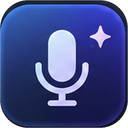

# ChatGPT Voice Hotkeys

A lightweight **Chrome/Chromium extension** for controlling ChatGPT's built-in voice dictation with customizable keyboard shortcuts. Works in Chrome, Edge, Brave and other compatible Chromium browsers.

## Shortcuts

| Shortcut | Action |
| --- | --- |
| **Alt + Z** | Start or stop voice recording |
| **Alt + X** | Send the voice recording or an already prepared message |

Click the extension icon to change either shortcut or restore the defaults. Shortcuts work while the ChatGPT web page is focused, not system-wide.

## Install

1. Download and extract the extension ZIP.
2. Open `chrome://extensions` (or your browser's extensions page).
3. Enable **Developer mode**, select **Load unpacked**, and choose the `ChatGPT-Voice-Hotkeys` folder.
4. Open `https://chatgpt.com` and allow microphone access when prompted.

## How it works

The extension clicks the controls already present in ChatGPT's web interface. It does **not** record, transcribe, upload or store audio itself. ChatGPT handles dictation using its own service. Shortcut preferences are stored using Chromium's `storage.sync` API.

**Access:** Runs only on `chatgpt.com` and `chat.openai.com`. Requires the `storage` permission for shortcut settings. No external APIs or servers.

## Notes

- This extension controls **dictation**, not ChatGPT's separate real-time Voice Mode.
- A ChatGPT interface update may require an extension update.
- After installing or updating the extension, refresh any ChatGPT tabs that were already open.
- `Alt + Z` can conflict with NVIDIA Overlay; change the shortcut in the extension popup if needed.
- This is an independent, unofficial project and is not affiliated with or endorsed by OpenAI.

**Version:** 0.1.0

[Author on GitHub](https://github.com/canyrtcn)
